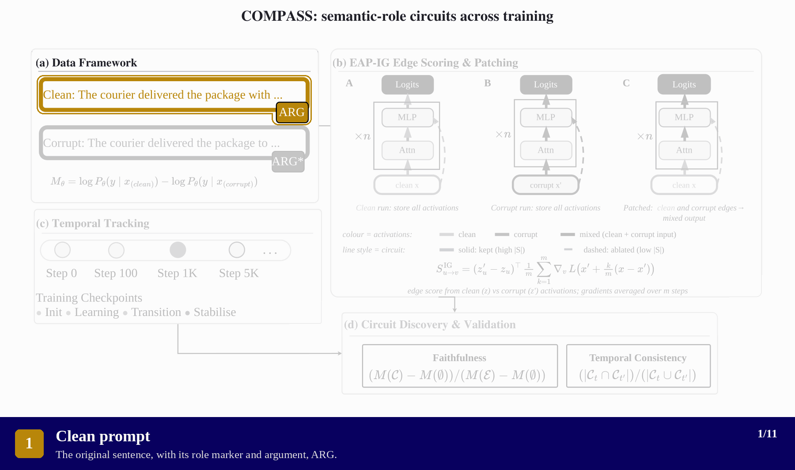

# Emergence and Localisation of Semantic Role Circuits in LLMs
[](https://www.python.org/downloads/)
[](https://www.gnu.org/licenses/gpl-3.0)

This repository contains the code for the paper "Emergence and Localisation of Semantic Role Circuits in LLMs" (Findings of ACL 2026).

## Overview

**COMPASS** is a causal-temporal methodology for studying how language models come to represent semantic roles. It combines contrastive minimal pairs, circuit discovery with edge attribution patching and integrated gradients (EAP-IG), and tracking across training checkpoints.

1. **Data framework:** each clean prompt is paired with a corrupt prompt that changes the semantic role marker; the metric is the log-probability gap between them.
2. **EAP-IG edge scoring:** activations from clean and corrupt runs are combined with gradients averaged along the input path from corrupt to clean, giving a score for every edge.
3. **Temporal tracking:** the analysis is repeated at training checkpoints.
4. **Validation:** circuits are evaluated by faithfulness and by their overlap across checkpoints.



The code works with the repository's own transformer implementation and with TransformerLens `HookedTransformer` models, and is designed for synthetic corpora generated with [ABSynth](https://github.com/nura-j/ABSynth_dataset). Alongside circuit discovery, it provides analysis modules for linguistic probes, intrinsic dimensions, Hessian spectra and output monitoring, and MechInt-DB, which stores circuits as OWL/RDF knowledge graphs.

## Setup

Use the provided `environment.yml` with Python 3.11. From the repository root:

```bash
conda env create -f environment.yml
conda activate compass
```

The environment installs Graphviz from conda-forge, which is needed to draw circuit graphs. Alternatively, install Graphviz on your system and use pip:

```bash
pip install -r requirements.txt
pip install pygraphviz==1.14
```

Both routes install [ABSynth](https://github.com/nura-j/ABSynth_dataset), the synthetic data generator, from GitHub.

## Usage

Run all commands and scripts from the repository root so that the `eap`, `trace` and `mechint_db` packages can be imported.

The example below trains a small decoder-only model on an ABSynth corpus and discovers semantic-role circuits with EAP-IG at regular checkpoints.

```python
import torch

from trace.dataloader import get_dataloader
from trace.tokenizer import create_tokenizer_from_data
from trace.training import Trainer, TrainingConfig
from trace.transformer import Transformer, TransformerConfig

CORPUS_PATH = "./data/corpus.json"           # ABSynth corpus
CNP_PATH = "./data/minimal_pairs.json"       # clean/corrupt minimal pairs

tokenizer = create_tokenizer_from_data(vocab_file=CORPUS_PATH)

model = Transformer.from_config(TransformerConfig(
    model_type="decoder_only",
    vocab_size=tokenizer.get_vocab_size(),
    d_model=512,
    n_heads=8,
    num_decoder_layers=2,
    d_ff=2048,
    n_ctx=128,
    dropout=0.1,
    device=torch.device("cpu"),
))

train_loader, val_loader, test_loader = get_dataloader(
    corpus_path=CORPUS_PATH,
    tokenizer=tokenizer,
    batch_size=32,
    max_length=128,
    model_type="decoder_only",
    val_split=0.1,
    test_split=0.1,
)

config = TrainingConfig(
    epochs=30,
    learning_rate=1e-3,
    batch_size=128,
    device="cuda",
    track_interval=500,                 # analyse every 500 steps
    track_eap=True,
    eap_method="EAP-IG-inputs",
    eap_ig_steps=5,
    eap_top_k=28,
    cnp_dataset_path=CNP_PATH,
    plots_path="./analysis_results",
)

trainer = Trainer(config, tokenizer, model)
best_loss, analysis_results = trainer.train(
    train_loader=train_loader,
    val_loader=val_loader,
    test_loader=test_loader,
)
```

The minimal-pair file is a JSON or CSV table with the columns `clean`, `corrupted`, `correct_idx` and `incorrect_idx`.

### Training arguments

| Argument | Purpose |
| --- | --- |
| `track_interval` | Number of training steps between analyses. |
| `track_eap` | Run circuit discovery at each analysis step. |
| `eap_method` | `EAP`, `EAP-IG-inputs`, `EAP-IG-activations`, or `clean-corrupted`. The default is `EAP`. |
| `eap_ig_steps` | Number of integrated-gradient steps `m` (default: `5`). |
| `eap_top_k` | Number of highest-scoring edges kept in the circuit (default: `50`). |
| `cnp_dataset_path` | Path to the minimal-pair dataset. |
| `enable_owl_export` | Also export each circuit to MechInt-DB as Turtle files. |
| `track_linguistic_probes` / `track_semantic_probes` | Track POS and semantic-role probes. |
| `track_intrinsic_dimensions` | Track the intrinsic dimension of hidden representations. |
| `track_hessian` | Track Hessian eigenvalues of the loss. |
| `track_pos_performance` / `track_semantic_roles_performance` | Track output accuracy by POS and semantic-role category. |
| `plots_path` | Folder for plots and analysis histories. |

### Analysis modules

Each module can also be used on its own. Usage guides are in `docs/`:

| Module | Import | Guide |
| --- | --- | --- |
| Transformer models | `trace.transformer` | [docs/transformer_models.md](docs/transformer_models.md) |
| Intrinsic dimensions | `trace.intrisic_dimensions` | [docs/intrinsic_dimensions.md](docs/intrinsic_dimensions.md) |
| Hessian analysis | `trace.hessian` | [docs/hessian_analysis.md](docs/hessian_analysis.md) |
| Linguistic probes | `trace.linguistic_probes` | [docs/linguistic_probes.md](docs/linguistic_probes.md) |
| Output monitoring | `trace.output_monitoring` | [docs/output_monitoring.md](docs/output_monitoring.md) |
| MechInt-DB | `mechint_db.integration` | [docs/mechint_db.md](docs/mechint_db.md) |
| ABSynth data | `trace.tokenizer`, `trace.dataloader` | [docs/absynth_data.md](docs/absynth_data.md) |

## Outputs

During training, analysis histories are written as JSON under `plots_path`, one folder per enabled module (for example `eap/eap_history.json` and `intrinsic_dimensions/intrinsic_dimension_history.json`). Circuit graphs are saved under `log_dir/eap_graphs/`, the model checkpoint is saved to `save_path`, and MechInt-DB exports are written as Turtle files under `owl_output_dir`. Generated results are stored locally and should not be committed.

## Repository layout

```text
.
├── README.md
├── environment.yml
├── requirements.txt
├── LICENSE.txt
├── compass_method.gif          # Method animation
├── docs/                       # Usage guides for the analysis modules
├── eap/                        # Circuit discovery with EAP and EAP-IG
│   ├── analyzer.py             # Attribution, top-k circuit and faithfulness
│   ├── attribute.py            # Edge scoring methods
│   ├── evaluate.py             # Circuit evaluation by patching
│   └── graph.py                # Model graph, edges and circuit export
├── mechint_db/                 # OWL/RDF knowledge base for circuits
│   ├── integration/            # EAP analysis with OWL export
│   ├── ontology/               # MechInt ontology schema
│   └── storage/                # Turtle exporter
└── trace/                      # Models, training and analysis modules
    ├── dataloader/
    ├── hessian/
    ├── intrisic_dimensions/
    ├── linguistic_probes/
    ├── output_monitoring/
    ├── tokenizer/
    ├── training/               # Trainer and analysis callbacks
    └── transformer/            # Transformer and hooked transformer models
```

## Citation

If you use this code in your research, please cite:

```bibtex
@inproceedings{aljaafari-etal-2026-emergence,
    title = "Emergence and Localisation of Semantic Role Circuits in {LLM}s",
    author = "Aljaafari, Nura  and
      Carvalho, Danilo  and
      Freitas, Andre",
    editor = "Liakata, Maria  and
      Moreira, Viviane P.  and
      Zhang, Jiajun  and
      Jurgens, David",
    booktitle = "Findings of the {A}ssociation for {C}omputational {L}inguistics: {ACL} 2026",
    month = jul,
    year = "2026",
    address = "San Diego, California, United States",
    publisher = "Association for Computational Linguistics",
    url = "https://aclanthology.org/2026.findings-acl.1964/",
    doi = "10.18653/v1/2026.findings-acl.1964",
    pages = "39402--39433",
    ISBN = "979-8-89176-395-1",
    abstract = "Despite displaying semantic competence, large language models' internal mechanisms that ground abstract semantic structure remain insufficiently characterised. To investigate whether and how LLMs develop causally functional representations of semantic roles, we introduce a causal-temporal methodology combining contrastive minimal pairs, edge-attribution circuit discovery, and training-time tracking. Our analysis reveals that LLMs encode semantic roles through highly localised circuits (89{--}92{\%} attribution within 28 nodes) that emerge gradually via structural refinement rather than phase transitions. These circuits exhibit moderate cross-scale conservation (24{--}51{\%} component overlap) alongside high spectral similarity, with larger models reusing similar components while rewiring connections. These findings suggest that LLMs form compact, causally isolated mechanisms for abstract semantic structure that exhibit partial transfer across scales and architectures."
}
```

## License

This project is licensed under the GPLv3 License - see the [LICENSE](LICENSE.txt) file for details.

The `eap` package builds on the EAP-IG code of [Hanna et al. (2024)](https://arxiv.org/abs/2403.17806).

## Contact

For questions or issues regarding this code, or for paper-related inquiries:
- Open an issue in this repository
- Contact: nuraaljaafari@gmail.com